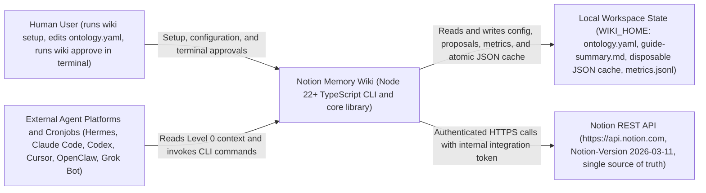

# Notion Memory Wiki Technical Design Doc

> Status: locked for implementation (Slice 1) | Date: 2026-11-23 | Inputs: [PRD.md](./PRD.md), [GLOSSARY.md](./GLOSSARY.md), [docs/research-decisions.md](./docs/research-decisions.md), [docs/pre-commitment-guard.md](./docs/pre-commitment-guard.md)

This document defines the architectural choices, system boundaries, security enforcement points, and quantitative contracts guiding direct vertical-slice implementation. Problem framing, personas, and user stories live in [PRD.md](./PRD.md), and domain terms follow [GLOSSARY.md](./GLOSSARY.md).

All architectural blockers from design review and official Notion API (`2026-03-11`) documentation checks are resolved below. The single remaining live behavior check (`GET /v1/blocks/{wiki_root_id}/children` on a native `wiki: true` home layout) runs directly inside Slice 1 integration testing.

## 1. Decisions

### 1.1 Ontology Model

- **Options:**
  1. **Layered Declarative Semantic-Kinetic Model (Option 1.1A):** A Semantic-Kinetic model separates the Semantic layer (workspace object types, properties, and directed relation links) from the Kinetic layer (allowed actions and their pre-write rules, splitting additive writes from `Destructive Actions`). This option keeps a disposable machine-synced Notion schema snapshot (`cache.json`, keyed by immutable `data_source_id`) separate from a human-editable `ontology.yaml` overlay (which binds user aliases and governance rules to immutable Notion IDs), paired with an optional 6-database starter kit modeled after LinkML (Linked Data Modeling Language, a YAML-based schema format) for blank workspaces.
  2. **Full Semantic Web Triple Store (Option 1.1B):** Store workspace metadata as RDF (Resource Description Framework, a graph data format built from subject-predicate-object triples) with OWL-RL (Web Ontology Language, Rule Language profile), SHACL (Shapes Constraint Language), and SPARQL or Cypher graph queries.
  3. **Flat Workspace Registry (Option 1.1C):** Maintain a flat `workspace.json` listing database titles and IDs only.
- **Chosen:** Option 1.1A (Layered Declarative Semantic-Kinetic Model).
- **Why:** Separating the machine-synced Notion snapshot (`cache.json`) from user-authored overlays (`ontology.yaml`) ensures Notion always wins on schema drift while preserving user aliases, 10-word database purposes, `Taxonomy` area grouping, `extra_required_fields`, excluded legacy databases, `Agent Operating Guide` page triggers, `Capture Inbox` placement, and `Agent Scope` definitions. Because `ontology.yaml` binds databases by `data_source_id` and binds field rules by Notion's immutable `property_id` (storing column names only as informational labels), user rules survive database and column renames in Notion without silent failures. Existing custom workspaces keep their original database names, while blank workspaces can opt into a 6-database starter ontology (`Projects`, `Tasks`, `Goals`, `Resources`, `Decisions`, `Capture Inbox`) plus a 4-page starter `Agent Operating Guide` created only after explicit user confirmation.
- **Rejected:** Option 1.1B introduces heavy open-world inference machinery (75+ files in the `cortexdb` reference) that breaks when users rename Notion columns and conflicts with Notion's closed relational schemas. Option 1.1C discards `Taxonomy` hierarchy, typed directed relation edges, hop-by-hop `Agent Scope` checks, and Level 2 `Fractal Structure` pointers.

### 1.2 Language, Runtime, Distribution, and Operating Systems

- **Options:**
  1. **TypeScript on Node 22+ (Node 24 LTS recommended) via pinned npm install (Option 1.2A):** Uses ESM (ECMAScript Modules, the standard JavaScript module format), built-in `fetch`, static discriminated unions for Notion JSON, and distribution as a pinned package installed globally via `npm install -g notion-memory-wiki@<version>`.
  2. **Go (Option 1.2B):** Compiles to a single static binary using standard-library `net/http` with fast CLI (Command-Line Interface) startup.
  3. **Python 3.12+ via `uv` (Option 1.2C):** Uses dynamic dictionaries with Pydantic validation and `httpx`.
- **Chosen:** Option 1.2A (TypeScript on Node 22+, with Node 24 LTS recommended because Node 22 reaches EOL, End of Life, on 2027-04-30), targeting **macOS and Linux on POSIX (Portable Operating System Interface) filesystems** in v1.0.
- **Why:** TypeScript aligns directly with the primary Notion open-source reference repositories (`makenotion/lore`, `notion-axi`, `easy-notion-mcp`, `notion-cli-agent`) and with the official `@modelcontextprotocol/sdk` if v1.1 adds an optional MCP (Model Context Protocol, a protocol exposing tools directly to AI hosts) adapter. TypeScript discriminated unions model Notion's nested property shapes (`select`, `status`, `relation`, `rich_text`, `verification`) safely at compile time, and built-in `fetch` avoids external HTTP client dependencies. Distributing as a pinned global npm install (`npm install -g notion-memory-wiki@<version>`) gives fast startup with zero registry lookup per command and avoids the supply-chain risk of unpinned `npx` executions (pinned `npx notion-memory-wiki@<version>` is reserved for one-off trial setup only). Agent platforms that use other runtimes, such as Hermes (Python) and Codex, invoke the installed `wiki` binary over shell without depending on Node inside the agent host.
- **Operating System Scope (v1.0):** `JsonMetadataStore` relies on POSIX `0o600` file permissions, `O_EXCL` lockfile creation, and atomic `fs.rename` semantics over open files. Therefore, v1.0 officially supports **macOS and Linux**. Windows users run v1.0 inside WSL2 (Windows Subsystem for Linux 2); native Windows support is deferred to a later release.
- **Rejected:** Option 1.2B (Go) produces a fast static binary, but every primary reference pattern and the official v1.1 MCP TypeScript SDK would require manual translation, and shipping precompiled binaries across macOS and Linux architectures adds cross-compilation and release signing overhead that is unnecessary for v1.0. Option 1.2C (Python) has slower per-command CLI startup (roughly 150 to 400 ms per invocation, compounding in multi-step cronjobs) and introduces virtual environment setup friction for tester friends who do not use `uv`.

### 1.3 Integration Surface and Level 0 Delivery

- **Options:**
  1. **AXI CLI + Runtime `SKILL.md` only (Option 1.3A):** Ship only an AXI (Agent eXperience Interface, a CLI formatted for compact AI consumption) plus bundled skills.
  2. **Thin 4-Tool MCP Server only (Option 1.3B):** Expose Notion Memory Wiki strictly as an MCP server.
  3. **Shared `core/` Library with AXI CLI + `SKILL.md` + `wiki render` in v1.0, Deferring Optional Thin 4-Tool MCP to v1.1 (Option 1.3C):** Keep `core/` transport-agnostic, ship one surface in v1.0, and leave room for a ~250-line in-process MCP adapter in v1.1.
- **Chosen:** Option 1.3C locked strictly to AXI CLI, runtime `SKILL.md`, and single-mode Level 0 delivery in v1.0 (optional thin 4-tool MCP adapter deferred to v1.1).
- **PRD Scope Exception (v1.0):** Although [PRD.md](./PRD.md) targets platform-agnostic adoption, v1.0 requires a shell-capable agent host. Shell-less MCP-only clients (such as web-only MCP hosts or desktop clients without shell execution) are excluded from v1.0 and deferred to v1.1's thin 4-tool MCP adapter, matching [docs/pre-commitment-guard.md](./docs/pre-commitment-guard.md).
- **Why:** Keeps v1.0 total Level 0 startup context between 655 and 985 tokens (with a hard sum-of-caps ceiling of 1,100 tokens, leaving 400 tokens of guaranteed headroom below 1,500 tokens). The CLI runs identically inside headless OS cronjobs (`launchd` and `cron` in `PRD.md` Story 5) and inside shell-capable agent platforms without spawning or supervising an MCP server process, avoids dual-surface maintenance overhead during v1.0 (`makenotion/lore` lesson), and avoids the `execFileSync` subprocess anti-pattern (`notion-cli-agent`) by keeping `core/` transport-agnostic for v1.1. Each agent profile uses **one canonical Level 0 injection mode**:
  - `render`: `wiki render` writes a bounded **Push block** (a delimited Markdown section embedded directly in a host's startup instruction file so the agent receives Level 0 context automatically on session start without running a command).
  - `hook`: a `SessionStart` hook runs `wiki wakeup --profile <name>` at session start.
  - `wakeup_on_demand`: `SKILL.md` directs the agent to run `wiki wakeup` on the first Notion turn.
  `wiki render` and `wiki hook install` actively refuse to install a conflicting mode (`AxiError(DUPLICATE_INJECTION_MODE)`), while `wiki doctor` audits host files and hooks to report manual double-injection with remediation steps.
- **Rejected:** Option 1.3B consumes 450 to 550 tokens for 4 stripped MCP tool schemas alone (leaving tighter headroom below 1,500 tokens), adds MCP server lifecycle management for headless cronjobs, and faces inconsistent host support for MCP `InitializeResult.instructions`. Shipping CLI and MCP together in v1.0 was rejected to prevent scope creep before validating setup with tester friends.

### 1.4 Local Storage, Sync, and Governance Placement

- **Options:**
  1. **Disposable SQLite WAL Index + Local `ontology.yaml` + Direct Notion Queries (Option 1.4A):** Local SQLite database in WAL (Write-Ahead Logging, a journal mode allowing concurrent readers and writers) mode with FTS5 (Full-Text Search 5, SQLite's built-in text indexing module).
  2. **Atomic JSON Files Behind a `MetadataStore` Interface + Local `ontology.yaml` + Direct Notion Queries (Option 1.4B):** Human-editable local `ontology.yaml` and `guide-summary.md` paired with disposable atomic JSON files (`cache.json`, `fractal-pointers.json`, `rate-limit-state.json`, `metrics.jsonl`, and one file per pending proposal under `proposals/<proposal_id>.json`).
  3. **Zero Local Cache (Option 1.4C):** Query the Notion REST (Representational State Transfer) API from scratch on every agent turn.
  4. **Notion-Hosted Overlay Page or Database (Option 1.4D):** Store `ontology.yaml`, `Agent Scope` definitions, and pending proposals inside a dedicated Notion page or database so multiple machines share state automatically.
- **Chosen:** Option 1.4B (Atomic JSON files behind a `MetadataStore` interface with local `ontology.yaml` in v1.0, upgrading to SQLite WAL later only if record-stub caching is added).
- **Single-Host Assumption (v1.0):** Local state under `$WIKI_HOME` coordinates processes on one machine only. Therefore, **v1.0 assumes one machine per Notion integration token**. Running two machines against the same token means each host maintains independent rate-limit windows and local proposal queues (so `wiki approve` must run on the machine that created the proposal, and per-host sustained rates should be lowered manually to avoid hitting Notion's shared workspace pool).
- **Why:** Confirmed workspaces typically hold 15 to 25 core databases (under 150 KB of metadata). Atomic temp-file write plus POSIX `fs.rename` with `0o600` permissions eliminates native C++ build dependencies (`better-sqlite3`) and avoids Node 22 `node:sqlite` experimental stderr warnings that would pollute AXI CLI output. Storing one file per pending proposal (`proposals/<proposal_id>.json`) removes cross-process write contention, while short advisory lockfiles protect read-modify-write updates on `fractal-pointers.json` and `rate-limit-state.json`. Offline accent-insensitive Portuguese and English alias search runs in under 1 ms using Unicode NFD (Normalization Form Decomposed, which splits base letters from accent marks) plus character trigram scoring over the loaded catalog. All JSON cache files are strictly disposable and rebuild 100% from Notion plus `ontology.yaml` via `wiki sync`, guaranteeing Notion-wins conflict resolution. Live database queries and page prose reads always query Notion directly.
- **Rejected:** Option 1.4A was deferred in v1.0 because SQLite driver and Node 22 stderr warning friction outweigh its benefits under 150 KB of metadata; the `MetadataStore` port keeps a future SQLite backend isolated from `core/`. Option 1.4C fails the under-5-minute setup, zero-blind-discovery, and cross-process HTTP 429 cooldown contracts. Option 1.4D (Notion-hosted overlay) was rejected because storing `Agent Scope` and validation rules inside Notion places governance policy inside the untrusted data plane (allowing any write-capable agent to modify its own scope or rules), adds network latency before startup Level 0 rendering, and removes Git-diffable local YAML editing.

### 1.5 Notion HTTP Client

- **Options:**
  1. **Raw Built-In `fetch` Client (Option 1.5A):** A ~150 to 250-line typed HTTP client targeting `https://api.notion.com` with `Notion-Version: 2026-03-11`.
  2. **Thin Wrapper Over Official `@notionhq/client` SDK (Option 1.5B):** Call the official JavaScript SDK (Software Development Kit) for standard endpoints and fall back to raw `fetch` for newer `2026-03-11` or Views API calls.
  3. **Subprocess Wrapper Over External `ntn` CLI Binary (Option 1.5C):** Shell out to `ntn` per API call (`notion-axi` pattern).
- **Chosen:** Option 1.5A (Raw built-in `fetch` client).
- **Why:** Supports `Notion-Version: 2026-03-11` endpoints (`/v1/pages/{id}/markdown`, `/v1/data_sources/{id}/query`, `GET /v1/views?data_source_id=...`, `POST /v1/pages/{id}/move`, `in_trash`, `meeting_notes`) immediately with zero SDK version lag. Gives direct access to raw HTTP `429` `Retry-After` headers and `additional_data.rate_limit_reason` payloads for cross-process pacing without fighting hidden SDK retries, and enforces a single strict `https://api.notion.com` host allowlist in one request function. Default authentication uses Notion internal integration tokens (which restrict access strictly to pages shared with that integration); PATs (Personal Access Tokens, which carry full human workspace permissions) stay disabled by default and require explicit opt-in with a warning.
- **Rejected:** Option 1.5B risks split SDK-and-raw code paths as Notion adds endpoints and requires disabling or unwrapping SDK retry behavior. Option 1.5C forces every user to install an external `ntn` binary, spawns a process per API call, regex-parses stderr without HTTP 429 mapping, and authenticates as the full human user instead of honoring Notion page sharing.

### 1.6 Setup and Maintenance Packaging

- **Options:**
  1. **Single CLI Package + `agentskills.io` Bundle + `wiki render` + Terminal Fallback (Option 1.6A):** Distribute one CLI bundling runtime `notion-wiki/SKILL.md` and removable onboarding `notion-wiki-setup/SKILL.md`, paired with zero-LLM terminal setup (`wiki setup`) and deterministic lint as the default maintenance mode.
  2. **Host-Specific MCP Auto-Installers Only (Option 1.6B):** Maintain separate installers writing host-specific MCP config files.
  3. **Prompt-Only Markdown Workflows (Option 1.6C):** Rely on `SKILL.md` prompts and loose scripts without runtime enforcement (`karpathy-llm-wiki` pattern).
- **Chosen:** Option 1.6A.
- **Why:** Portable across Hermes, Claude Code, Codex, Cursor, OpenClaw, OpenBot, and Grok Bot while requiring zero internal LLM API keys inside Notion Memory Wiki.
  - **Bounded two-level discovery and deterministic fallback:** `wiki setup` always combines three bounded signals: (1) a 2-level block scan from `workspace.root_id` plus, on a native `wiki: true` root, the official Notion Wiki root query `POST /v1/data_sources/{root_ds_id}/query` (using `result_type` to enumerate direct child pages and child data sources without reading page prose or querying rows of any child/content database); (2) one paginated `POST /v1/search` (`filter: { property: "object", value: "data_source" }`) returning full `data_source` schemas, `parent.database_id`, and stable property `id`s; and (3) `GET /v1/views?data_source_id=...` to discover linked views, resolving each view's `parent.database_id` container back to its host hub page via matching `unsupported`/`child_database` block IDs or `GET /v1/databases/{view.parent.database_id}`. Completeness is checked deterministically: any `data_source_id` returned by `POST /v1/search` that is not placed into a hub, or any hub containing unmatched `unsupported` blocks, is surfaced explicitly in interactive hub-placement confirmation so no inline linked view is silently dropped.
  - **Guide refresh and maintenance:** `Agent Operating Guide` summaries never trigger silent background LLM calls; stale guide pages emit a one-line notice and refresh only on explicit user action (connected agent proposal plus confirmation, direct manual edit setting `user_pinned: true`, or zero-LLM `wiki guide refresh --deterministic`). Optional off-peak `Context Maintenance` is disabled by default, scans only pages inside `Root Page` and the user-designated Notion `Capture Inbox`, defaults to deterministic lint checks (zero LLM calls), and supports opt-in off-peak `llm_assisted` updates where the user's external agent platform executes LLM calls and every Notion write passes through `core/`. In `llm_assisted` mode, avoiding LLM provider HTTP `429 (1302)` concurrency errors relies on scheduling runs outside active chat hours (or using a separate LLM quota), reinforced by `wiki lint --emit-candidates` exiting with code `75` (`YIELD_ACTIVE_CHAT`) whenever interactive chat ran within the last 60 seconds.
- **Rejected:** Option 1.6B creates configuration churn across 7+ agent hosts and leaves out headless shell cronjobs. Option 1.6C cannot enforce `Agent Scope`, deterministic `Validation`, cross-process HTTP 429 pacing, or `ApprovalGate` proposals at runtime.

---

## 2. System Architecture

### 2.1 C4 Level 1 (System Context)

C4 (Context, Containers, Components, and Code) Level 1 shows external actors and system boundaries.



### 2.2 C4 Level 2 (Container and Module Architecture)

C4 Level 2 shows internal containers, core governance services, and infrastructure adapters. TOON (Token-Oriented Object Notation) is the compact text output format used to minimize response tokens.

```mermaid
flowchart TD
    subgraph delivery["Presentation and Delivery Layer (src/cli and skills)"]
        cli["AXI CLI Commands (setup, sync, render, hook, wakeup, doctor, catalog, read, query, write, schema, approve, guide, lint, metrics)"]
        fmt["TOON Formatter, Nonce Wrapper, and AxiError Renderer"]
        skills["Bundled agentskills.io Files (notion-wiki/SKILL.md and notion-wiki-setup/SKILL.md)"]
        mcpv11["Reserved v1.1 Thin 4-Tool MCP Adapter (deferred to v1.1)"]
    end

    subgraph core["Core Domain and Governance Layer (src/core, transport-agnostic)"]
        scope["ScopeGuard (monotonic narrowing, fail-closed profile lock, hop and rollup filtering)"]
        onto["OntologyEngine (Taxonomy, alias resolver, Level 0 renderer, >30 DB overflow)"]
        val["WriteValidator (deterministic zero-LLM schema, property_id and option checks)"]
        gate["ApprovalGate (default-approval classifier, SHA-256 content-hash proposal lifecycle)"]
        sync["SyncService (2-level discovery + search reconciliation, Notion-wins drift sync, L2 fractals)"]
        lint["LintService (deterministic off-peak maintenance, Capture Inbox audit, yield check)"]
        ports["Ports (NotionGateway, MetadataStore, RateLimiter, SecretStore, MetricsLogger)"]
    end

    subgraph infra["Infrastructure Layer (src/infra)"]
        http["NotionHttpClient (raw fetch, api.notion.com allowlist, URI sanitizer)"]
        store["JsonMetadataStore (atomic POSIX temp+rename 0o600, O_EXCL lockfile, per-file proposals, CST YAML editor)"]
        rl["CrossProcessRateLimiter (token bucket, shared 429 cooldown, 60s chat yield)"]
        tok["TokenProvider (OS Keychain primary, 0o600 token file fallback, env var for headless only)"]
        met["JsonlMetricsLogger (append-only metrics.jsonl rotated at 5 MB, zero prose)"]
    end

    cli --> fmt
    cli --> scope
    cli --> onto
    cli --> val
    cli --> gate
    cli --> sync
    cli --> lint
    mcpv11 -.->|"v1.1 in-process calls"| scope

    scope --> ports
    onto --> ports
    val --> ports
    gate --> ports
    sync --> ports
    lint --> ports

    http -.->|"implements NotionGateway"| ports
    store -.->|"implements MetadataStore"| ports
    rl -.->|"implements RateLimiter"| ports
    tok -.->|"implements SecretStore"| ports
    met -.->|"implements MetricsLogger"| ports
```



### 2.3 Local Data Schema

All local state resides under `$WIKI_HOME` (default `~/.config/notion-memory-wiki/<workspace>/`) on macOS or Linux POSIX filesystems, created with directory permissions `0o700` and file permissions `0o600`. Every JSON update writes to a temporary file in the same directory and replaces the target with atomic `fs.rename` so concurrent readers never observe partial JSON.

| File Path | Ownership and Lifecycle | Schema Summary |
|---|---|---|
| `ontology.yaml` | User-owned workspace contract holding user overlays and immutable Notion identity bindings (`root_id`, `data_source_id`, `hub_page_id`, `page_id`, `property_id`). Strictly read-only during `wiki sync`; modified only by explicit user commands (`wiki setup`, `wiki catalog add`, `wiki catalog exclude`, `wiki guide pin`) using the `yaml` npm package `parseDocument` CST (Concrete Syntax Tree, a syntax representation that preserves comments and whitespace) API so user comments and formatting stay intact. | Specified in Section 2.4. |
| `guide-summary.md` | User-confirmed Level 0 `Agent Operating Guide` summary and "open when" page index (`<= 400` tokens). | Plain Markdown; manual edits protected by `guide.user_pinned: true` in `ontology.yaml`. |
| `cache.json` | Disposable machine-synced Notion snapshot keyed by immutable `data_source_id`; rebuilt 100% by `wiki sync` (Notion always wins). | `{ schema_version, synced_at, root: { id, type, is_wiki }, taxonomy_nodes[], data_sources: Record<data_source_id, { database_id, title, parent_node_id, last_edited_time, schema_hash, properties: Record<property_id, { name, type, read_only, options?, relation_target_data_source_id?, rollup_relation_property_name?, formula_expression? }> }>, relation_edges: [{ from_data_source_id, property_id, property_name, to_data_source_id }], guide_pages: [{ page_id, title, last_edited_time, summary_synced_at, summary_stale }] }` |
| `fractal-pointers.json` | Disposable lazy Level 2 `Fractal Structure` map populated only when an agent opens a record containing nested sub-databases. | `{ schema_version, by_parent_page_id: Record<page_id, [{ child_database_id, child_data_source_id, title, discovered_at, last_verified_at }]> }` |
| `proposals/<proposal_id>.json` | Operational approval queue storing one file per pending `Destructive Action` or schema edit (zero write contention across parallel processes). | `{ proposal_id, category ("destructive" \| "schema"), created_at, expires_at, profile, action_type, target_id, target_alias, expected_content_hash, expected_last_edited_time, summary, diff, payload, status }` |
| `rate-limit-state.json` | Operational cross-process pacing and HTTP 429 cooldown state shared across CLI processes on the same host. | `{ updated_at, retry_after_until, last_reason, last_active_chat_at, endpoints: Record<endpoint_key, { tokens, last_refill_ms, retry_after_until }> }` |
| `metrics.jsonl` | Append-only JSONL (JSON Lines, one JSON object per line) operational audit log rotated at 5 MB to measure the 30-day PRD accuracy and HTTP 429 targets; stores metadata only and zero Notion page prose. | `{ ts, profile, command, target_alias, resolved_via ("alias" \| "search" \| "raw_url" \| "fractal"), outcome ("ok" \| "validation_error" \| "scope_denied" \| "proposal_created" \| "http_429" \| "error"), error_code, http_status, notion_calls, duration_ms }` |
| `locks/<name>.lock` | Short-lived advisory lockfile created atomically with `O_EXCL` (a POSIX flag that fails if the file already exists), holding PID (Process Identifier) and timestamp; locks older than 5 seconds are reclaimed as stale. Protects read-modify-write on `fractal-pointers.json` and `rate-limit-state.json`. | `{ pid, acquired_at }` |

### 2.4 `ontology.yaml` Contract

All IDs below are synthetic placeholder UUIDs (Universally Unique Identifiers). Property-level rules bind to Notion's immutable `property_id` while keeping `label` as a human-readable hint so renaming columns in Notion does not break validation.

```yaml
version: 1

workspace:
  name: personal-wiki
  root_id: "00000000-0000-0000-0000-000000000000"
  root_type: wiki_database # "page" | "wiki_database"
  approved_linked_view_ids: []

taxonomy:
  - id: work
    label: "Project Management"
    alt_labels: ["projetos", "tasks"]
    hub_page_id: "00000000-0000-0000-0000-000000000001"
  - id: wellbeing
    label: "Daily and Wellbeing"
    alt_labels: ["saude", "daily log"]
    hub_page_id: "00000000-0000-0000-0000-000000000002"

databases:
  projects:
    data_source_id: "00000000-0000-0000-0000-000000000011"
    area: work
    purpose: "Track active projects, status, and linked tasks" # <= 10 words
    alt_labels: ["projetos", "project db"]
    pinned_level0: false
    extra_required_fields:
      - property_id: "a1b2"
        label: "Status" # informational only; runtime matches property_id
    numeric_bounds: {} # keyed by property_id: { label, min?, max? }
    stale_after_days: 30
    allow_wiki_verification: false

excluded_data_source_ids:
  - "00000000-0000-0000-0000-000000000099" # legacy or duplicate DB excluded during setup

guide:
  enabled: true
  summary_file: "guide-summary.md"
  user_pinned: false
  pages:
    - page_id: "00000000-0000-0000-0000-000000000020"
      title: "Processes (SOPs)"
      open_when: "Before executing recurring workspace procedures"

capture_inbox:
  id: "00000000-0000-0000-0000-000000000030"
  type: page # "page" | "database"

agent_scopes:
  work_agent:
    injection_mode: render # "render" | "hook" | "wakeup_on_demand" (exactly one per profile)
    render_target: "~/workspace/AGENTS.md" # absolute path or ~/ home-expanded path (never relative to cwd)
    token_ref: "keychain:nmw/personal-wiki/work_agent" # keychain entry or 0o600 file path
    allow_areas: ["work"]
    allow_databases: []
    deny_databases: []
    allow_guide_pages: "all" # "all" | string[] of page_ids
    read_only: false
  wellbeing_agent:
    injection_mode: hook
    token_ref: "keychain:nmw/personal-wiki/wellbeing_agent"
    allow_areas: ["wellbeing"]
    allow_databases: []
    deny_databases: []
    allow_guide_pages: "all"
    read_only: false
  reader_agent:
    injection_mode: render
    render_target: "~/agents/reader/INSTRUCTIONS.md"
    token_ref: "keychain:nmw/personal-wiki/reader_readonly" # Notion integration with Read-content capability only
    allow_areas: ["*"]
    allow_databases: []
    deny_databases: []
    allow_guide_pages: "all"
    read_only: true

maintenance:
  enabled: false
  mode: deterministic # "deterministic" | "llm_assisted"
  max_pages: 200
  report_page_id: null
```

**Scope Resolution Formula:** For any profile, the set of permitted databases is computed deterministically as:

$$\text{Permitted Databases} = \big(\text{DatabasesIn}(\texttt{allow\_areas}) \cup \texttt{allow\_databases}\big) \setminus \texttt{deny\_databases}$$

An empty array `[]` denotes the empty set $\emptyset$. The wildcard `"*"` in `allow_areas` expands to all confirmed `taxonomy` areas, and `"*"` in `allow_databases` expands to all confirmed `databases` (including databases without an area).

### 2.5 Folder Structure and Layer Dependency Rule

```text
notion-memory-wiki/
  src/
    cli/                    # Argument parsing, command handlers, TOON formatter, nonce wrapper, AxiError printer, bootstrap
    core/                   # Transport-agnostic domain services and governance gates
      ports.ts              # NotionGateway, MetadataStore, RateLimiter, SecretStore, MetricsLogger interfaces
      scope/                # ScopeGuard (monotonic narrowing, fail-closed profile lock, hop and rollup/formula filter)
      ontology/             # OntologyEngine (Taxonomy, Level 0 renderer, >30 DB overflow, NFD+trigram search)
      validation/           # WriteValidator (zero-LLM schema, property_id, read-only, option snap, required fields)
      approval/             # ApprovalGate (default-approval classifier, SHA-256 content-hash proposals, apply)
      sync/                 # SyncService (2-level setup + search reconciliation, Notion-wins drift sync, L2 fractals)
      lint/                 # LintService (deterministic maintenance checks, Capture Inbox inventory, active-chat yield)
    infra/                  # Concrete implementations of core/ports.ts
      notion/               # NotionHttpClient (raw fetch, 2026-03-11, allowlist, URI sanitizer)
      storage/              # JsonMetadataStore (atomic POSIX temp+rename 0o600, O_EXCL lockfile, CST YAML editor)
      ratelimit/            # CrossProcessRateLimiter (shared 429 cooldown, 60s active-chat yield)
      auth/                 # TokenProvider (OS Keychain primary, 0o600 token file fallback, headless env var)
      metrics/              # JsonlMetricsLogger (append-only metrics.jsonl rotated at 5 MB)
    shared/                 # Pure types, AxiError codes, calibrated token estimator, Unicode NFD helpers
  skills/
    notion-wiki/            # Runtime agentskills.io SKILL.md (frontmatter <= 90 tok, on-demand body <= 450 tok)
    notion-wiki-setup/      # Removable onboarding agentskills.io SKILL.md (frontmatter <= 70 tok)
  templates/
    starter-ontology/       # Optional 6-DB starter ontology and 4-page starter Agent Operating Guide
  tests/
    unit/                   # Pure core/ tests using in-memory fakes for ports.ts + Portuguese tokenizer calibration tests
    integration/            # Live Notion 2026-03-11 API and cross-process concurrency tests
```

**Layer Dependency Rule:**
- Dependencies point strictly inward: `src/cli/` (and reserved v1.1 `src/mcp/`) imports only `src/core/` and `src/shared/`, wiring `src/infra/` exclusively in `src/cli/bootstrap.ts`.
- `src/core/` imports only `src/shared/`; it forbids direct imports of `src/cli/`, `src/infra/`, `node:fs`, or global `fetch`.
- `src/infra/` implements interfaces from `src/core/ports.ts` and imports only `src/core/ports.ts` and `src/shared/`.
- Every operation enters through `src/core/` services so no interface surface can bypass `ScopeGuard`, `WriteValidator`, or `ApprovalGate`. CI (Continuous Integration, automated checks run on code changes) enforces these import rules via static lint checks.

---

## 3. Security and Governance Boundaries

### 3.1 Threat Model: Platform-Enforced Boundaries vs Application-Level Governance

Any agent with unrestricted shell access running under the same OS user as the CLI can inspect local files or invoke `curl` directly against `https://api.notion.com`. Therefore, local code gates inside `src/core/` protect against **agent mistakes, unintended CLI writes, and prompt injection that stays inside CLI commands**, while **Notion server permissions and Notion recovery features** provide the hard platform backstop against a compromised shell agent.

| Boundary | Enforcement Mechanism | Security Class | What It Guarantees and What It Does Not |
|---|---|---|---|
| **Notion workspace and capability isolation** | Notion internal integration token page-sharing permissions and capability toggles (`Read content`, `Insert content`, `Update content`) configured in Notion (`notion.so/profile/integrations`). Profiles with `read_only: true` use a separate Notion integration token with only `Read content` enabled. | Platform-enforced (Notion server) | Cannot be bypassed even by a prompt-injected shell agent using raw `curl`, because the Notion server rejects unshared pages and rejects writes on read-only tokens. PATs stay disabled by default and require explicit opt-in with a warning. |
| **Token confidentiality at rest** | `TokenProvider` resolves secrets in fixed order: (1) OS Keychain (macOS Keychain or Linux Secret Service), (2) `0o600` token file under `$WIKI_HOME/tokens/`, (3) environment variable for headless servers/cronjobs only (`wiki doctor` warns if `NOTION_TOKEN` is exported in an interactive shell). | OS secret hygiene | Removes tokens from `env` dumps, subshell inheritance, and agent crash logs. Does not stop an intentional attacker running shell commands as the same OS user from querying the user's unlocked keychain or token file. |
| **Destructive and schema-change approval gate** | `ApprovalGate` inside `src/core/` halts destructive or schema writes into `proposals/<proposal_id>.json`, requiring terminal execution of `wiki approve <proposal_id>` paired with host harness `ask` or deny rules blocking `wiki approve`. | Application-level CLI gate + host harness rule | Prevents accidental destructive writes and prompt-injected CLI self-approval (no `--force` flag or approval token exists). Does **not** stop a compromised shell agent that extracts a read-write token and calls `api.notion.com` via `curl`; in that event, recovery relies on Notion's 30-day Trash and Page Version History. |
| **Outbound network isolation** | Hard `https://api.notion.com` host allowlist in `NotionHttpClient` (`redirect: "error"` on cross-host redirects). | Code-enforced inside CLI | Prevents Notion Memory Wiki from executing `Autonomous External Actions`; no email, chat, or third-party SaaS clients exist in the package. Does not restrict external shell commands run directly by the host agent. |
| **Per-agent `Agent Scope`** | `ScopeGuard` inside `src/core/` with fail-closed profile resolution and `WIKI_AGENT_PROFILE` environment lock. | Application-level operational governance | Prevents accidental cross-area reads, writes, relation hops, and rollup leaks inside a shared integration token. Hard isolation between agents requires separate Notion internal integration tokens per profile. |

### 3.2 Exact Enforcement Points

1. **`Root Page` Boundary (`SyncService` and `OntologyEngine`):**
   - `wiki setup` begins strictly at `workspace.root_id` (accepting either a regular Notion page or a native `wiki: true` database) and persists only user-confirmed core databases and `approved_linked_view_ids`.
   - Row queries are strictly prohibited on all child and content databases during setup. **Native `wiki: true` root discovery:** per Notion's official Data Sources API, a native Wiki root is a database container whose direct children (pages and child data sources) are enumerated via `POST /v1/data_sources/{root_ds_id}/query` (supporting `result_type: "page"` or `"data_source"`), extracting only IDs, titles, and parent links with zero prose reads and zero row queries on any child or content database.
   - At runtime, `OntologyEngine` resolves short aliases defined in `ontology.yaml` and `cache.json` or Level 2 `fractal-pointers.json` entries attached to an authorized parent record. Arbitrary raw Notion UUIDs outside the authorized workspace map are verified by walking parent pointers upward for **at most 4 `GET` calls** (session-cached); if `workspace.root_id` or an approved linked-view database is not reached within 4 hops, the request fails with `AxiError(OUT_OF_ROOT_SCOPE)`.

2. **`Agent Scope` (`ScopeGuard` in `src/core/scope/`):**
   - **Fail-closed profile resolution:** Whenever `agent_scopes` defines **more than one profile**, running the CLI without `WIKI_AGENT_PROFILE` or `--profile <name>` fails immediately with `AxiError(PROFILE_REQUIRED)` listing configured profile names. Auto-selection occurs only when `agent_scopes` contains exactly one profile.
   - **Environment profile lock:** Whenever `WIKI_AGENT_PROFILE` is set in the process environment, passing a conflicting `--profile` CLI flag fails immediately with `AxiError(SCOPE_LOCKED)`.
   - **Host Profile-Binding Table:**

| Agent Host | How Profile Is Bound | Lock Level |
|---|---|---|
| **Hermes** | Per-agent environment block (`WIKI_AGENT_PROFILE=<name>`) in agent config | Process-env locked (`SCOPE_LOCKED`) |
| **Claude Code** | Project or profile `.claude/settings.json` `env.WIKI_AGENT_PROFILE` plus `SessionStart` hook | Process-env locked (`SCOPE_LOCKED`) |
| **Codex** | Wrapper command or shell profile exporting `WIKI_AGENT_PROFILE=<name>` | Process-env locked (`SCOPE_LOCKED`) |
| **Other editor or prompt-file hosts** | Rendered Push block in any configured `render_target` file instructing `--profile <name>` (or terminal env `WIKI_AGENT_PROFILE=<name>` when supported by the host) | Cooperative flag (env-locked when terminal env is set) |
| **OpenClaw, OpenBot, Grok Bot** | Bot process environment variable `WIKI_AGENT_PROFILE=<name>` (or `--profile <name>` inside rendered system prompt when per-bot env is unavailable) | Process-env locked when env is configured; cooperative flag otherwise |
| **OS Cronjobs (`launchd` / `cron`)** | Inline `WIKI_AGENT_PROFILE=<name> wiki ...` in job definition | Process-env locked (`SCOPE_LOCKED`) |

   - **Monotonic narrowing and set algebra:** `Agent Scope` can only narrow the `Root Page` and Notion sharing boundary, never expand it. Permitted databases equal `(DatabasesIn(allow_areas) U allow_databases) \ deny_databases`.
   - **Four mandatory checkpoints inside `src/core/`:**
     1. **Level 0 rendering (`wiki render`, `wiki wakeup`):** Omits every database and `Taxonomy` area outside the profile's scope and excludes any guide page omitted from `allow_guide_pages`.
     2. **Level 1 reads, queries, and writes:** Verifies target database alias and `read_only` flag before issuing any Notion HTTP request (`AxiError(SCOPE_DENIED)`). Strips any `rollup` property whose underlying `relation` targets a `data_source_id` outside the profile's scope, and replaces any `formula` property whose `formula.expression` references a stripped `rollup` or blocked `relation` with `[REDACTED:SCOPE_DENIED]`.
     3. **`Knowledge Graph` relation traversal:** Checks target `data_source_id` on every hop. Explicit traversal commands targeting a blocked database (`wiki read <id>` or `wiki query --follow <relation>`) fail immediately with `AxiError(SCOPE_DENIED)`. Reading an allowed record that contains a `relation` field pointing to a blocked database returns the record with that relation field masked as `[REDACTED:SCOPE_DENIED]` without leaking target IDs or titles.
     4. **`Agent Operating Guide` reads:** Allowed across profiles by default unless `allow_guide_pages` explicitly restricts access to specific `page_id` values.

3. **Deterministic `Validation` (`WriteValidator` in `src/core/validation/`):**
   - Runs with zero LLM calls before every Notion create or update.
   - Enforces eight checks in order: (a) `Agent Scope` write permission; (b) schema availability in `cache.json` (performing at most one reactive refresh of that single `data_source_id` on unknown `property_id`, unknown option, or HTTP `400 validation_error`); (c) non-empty `title` on page creation; (d) property existence and type conformance (resolving user-configured rules by immutable `property_id`); (e) strict write-block on read-only Notion properties (`formula`, `rollup`, `created_time`, `last_edited_time`, `created_by`, `last_edited_by`, `button`, `auto_increment_id`), while allowing writable Wiki `verification` (`state` and `date`, stripping Notion-managed `verified_by`); (f) valid `select`, `multi_select`, and `status` options with case-insensitive snap to Notion's exact casing (falling back to live-row option discovery when Notion omits dynamic options); (g) valid relation target `data_source_id` plus `ScopeGuard` authorization on the target database; and (h) user-declared `extra_required_fields` and optional `numeric_bounds` from `ontology.yaml` matched by `property_id`.
   - **Blocking silent `select` and `multi_select` schema drift:** Because Notion's API automatically creates a new schema option when an unknown string is written to a `select` or `multi_select` property, `WriteValidator` blocks unknown options by default so typos or agent hallucinations cannot pollute database schemas. To create a new tag or option intentionally, the agent invokes `wiki schema propose-option <alias> <property> <value>` (or passes `--propose-new-option`), which routes through `ApprovalGate` as a schema-change proposal.
   - On failure, aborts before any network call and returns a compact `AxiError` naming the failing field, the exact failure reason, and the valid options for that single field only.

4. **Default-Approval `Destructive Action` and Schema-Change Gate (`ApprovalGate` in `src/core/approval/`):**
   - **Default rule:** `ApprovalGate` uses an explicit allowlist of non-destructive writes. Any mutation not listed in the allowlist below halts immediately for human approval.
   - **Explicit non-destructive allowlist (allowed without approval after `WriteValidator` passes):**
     1. Creating a new page or database record (`POST /v1/pages`).
     2. Appending Markdown to an existing page (`PATCH /v1/pages/{id}/markdown` append mode, `allow_deleting_content: false`).
     3. Populating an empty `rich_text` property.
     4. Routine non-empty scalar updates on `status`, `select`, `date`, `checkbox`, `number`, `url`, `email`, `phone_number`, and Wiki `verification` (`state`, `date`).
     5. Additive array updates on `relation` and `multi_select` via `--add` (CLI fetches current array, appends new values, and writes the union) and explicit single-item `--remove <item>` only when at least one item remains in the property.
   - **Halted immediately (always creates a pending proposal requiring terminal `wiki approve <proposal_id>`):**
     1. Archiving or trashing a page or record (`in_trash: true`).
     2. Moving a page (`POST /v1/pages/{id}/move`; moves targeting a parent outside `Root Page` or outside `Agent Scope` are rejected outright by `ScopeGuard` before proposal creation).
     3. Clearing any currently populated property (setting `null`, `""`, or `[]`, including removing the final item from `relation` or `multi_select`).
     4. Replacing a populated `relation` or `multi_select` array via `--set` whenever one or more existing items would be dropped.
     5. Overwriting any currently non-empty `title` or `rich_text` property.
     6. Overwriting or deleting existing non-empty page prose (`PATCH /v1/pages/{id}/markdown` replace mode or `allow_deleting_content: true`).
     7. Any Notion schema edit (`PATCH /v1/data_sources/{id}`), including adding a new `select` or `multi_select` option via `wiki schema propose-option`.
   - **Approval protocol and SHA-256 concurrency guard:** Because Notion rounds `last_edited_time` down to the nearest minute, timestamp comparison alone misses edits made within the same minute. `ApprovalGate` computes `expected_content_hash` (SHA-256, Secure Hash Algorithm 256-bit, over the canonicalized target properties JSON for property/archive/move proposals, Markdown content for prose proposals, or `data_source` schema JSON for schema proposals) and writes `proposals/<proposal_id>.json` (`0o600`) with a 24-hour TTL (Time to Live, the expiration window). The CLI prints only `proposal_id` and the human-readable diff, with no `--force` flag or executable approval token. Execution runs exclusively through `wiki approve <proposal_id>` (covering both `category: "destructive"` and `category: "schema"`), which re-fetches the target from Notion, recomputes the SHA-256 hash, and aborts with `AxiError(CONFLICT_STALE_TARGET)` if the target changed after proposal creation.

5. **Prompt-Injection Hygiene (`NotionHttpClient` and `src/cli/` formatter):**
   - Every Notion prose block returned by `wiki read`, `wiki query`, or `wiki guide` is enclosed in a per-response boundary delimiter containing a cryptographically random 16-hex-character nonce generated via `crypto.randomBytes(8).toString("hex")`:
     `<<<UNTRUSTED_NOTION_CONTENT nonce=<16-hex> >>>` ... `<<<END_UNTRUSTED_NOTION_CONTENT nonce=<16-hex> >>>`
     This prevents malicious page text from spoofing a static closing delimiter.
   - The response sanitizer strips `javascript:` and `data:` URI (Uniform Resource Identifier) schemes from Markdown and rich-text links before printing output.

---

## 4. Performance, Token Budget, and Rate-Limit Contracts

### 4.1 Hard Level 0 Startup Token Budget (< 1,500 Tokens Total)

Token budgets are checked mechanically by `wiki render`, `wiki wakeup`, `wiki doctor`, and CI using a Portuguese-calibrated upper-bound estimator (`Math.ceil(chars / 2.8)`) because accented Portuguese and Markdown/TOON punctuation produce more tokens per character than plain English. CI runs a calibration suite that tokenizes representative Portuguese and English Level 0 fixtures against actual model tokenizers (`tiktoken` `o200k_base` and `cl100k_base`, plus reference Anthropic and Gemini token counts) and fails the build if `Math.ceil(chars / 2.8)` undercounts any fixture.

| Level 0 Component | Delivery Channel | v1.0 AXI CLI + Skill Budget | Reserved v1.1 4-Tool MCP Budget | Hard Validator and CI Cap |
|---|---|---|---|---|
| 1. Interface or tool surface | Runtime `notion-wiki/SKILL.md` frontmatter (~80 tok) + optional `notion-wiki-setup/SKILL.md` frontmatter (~60 tok, removable after setup) + 6-line CLI micro-card (~110 tok); or 4 flat MCP tools in v1.1 (no `outputSchema`) | 180 to 250 tok | 450 to 550 tok | CLI `<= 280` tok; v1.1 MCP `<= 550` tok (runtime `SKILL.md` on-demand body `<= 450` tok, excluded from Level 0 startup) |
| 2. Scoped Level 0 database catalog | Single-mode `wiki render` Push block or `SessionStart` `wiki wakeup` (15 to 25 active DBs x ~15 tok: `alias \| area \| <=10-word purpose`; zero UUIDs, columns, options, or L2 fractal DBs) | 225 to 375 tok | 225 to 375 tok | Warn `> 380` tok; hard cap `<= 420` tok (triggers overflow rule in Section 4.2) |
| 3. `Agent Operating Guide` summary + index | Same Push block or hook (~180 to 240 tok core summary + ~70 to 120 tok index of 6 to 8 pages with "open when" triggers; 0 tok when no guide exists) | 250 to 360 tok | 250 to 360 tok | Hard cap `<= 400` tok via `wiki guide validate` and `wiki render` |
| **Total Level 0 Startup Context** | Combined static and startup injection | **655 to 985 tok** (sum of caps `1,100` tok; `>= 400` tok margin) | **925 to 1,285 tok** (sum of caps `1,370` tok; `>= 130` tok margin) | **Hard ceiling `< 1,500` tok** |

**Level 1, Level 2, Setup, Sync, and Telemetry Budgets:**
- **Initial setup (`wiki setup`):** Bounded 2-level scan plus paginated `data_source` search and Views API reconciliation, executing roughly **100 to 200 API calls** (~40 to 80 seconds at 2.5 req/s on Free/Plus plans for a ~23-hub, ~50-candidate workspace; roughly 15 to 30 calls / ~10 seconds on a small 4-database workspace), keeping total interactive setup including user confirmation well under the 5-minute PRD target.
- **Routine structural sync (`wiki sync`):** Refreshes only confirmed core `data_source_id`s and `guide_pages` timestamps, executing roughly **25 to 35 API calls** (~10 to 15 seconds).
- **Loose UUID parent-chain verification:** Up to **1 to 4 upward `GET` calls** (session-cached) when an agent passes a raw Notion UUID not already indexed in `cache.json` or `fractal-pointers.json`.
- **Level 1 bounded outputs:** `wiki read` defaults to a 1,500-character Markdown preview (explicit `--full` paginates at 6,000 characters); `wiki query` defaults to `--limit 20` with `--fields` projection and compact TOON formatting so unrelated databases and raw block metadata remain outside the agent's context window.
- **Level 2 `Fractal Structure` cost:** 0 tokens at Level 0 and Level 1; nested sub-databases inside an individual record are discovered and stored in `fractal-pointers.json` only when an agent explicitly opens that record.
- **PRD metrics verification (`wiki metrics`):** Every CLI invocation appends one metadata record to `$WIKI_HOME/metrics.jsonl` (zero page prose). `wiki metrics --days 30` computes the 30-day link-free task resolution rate (`resolved_via != "raw_url"` vs the `>= 90%` PRD target) and total HTTP `429` count (vs the `0` PRD guardrail).

### 4.2 Level 0 Over-30-Database Overflow Rule and Single-Injection Contract

- **Overflow trigger:** Whenever a profile's scoped catalog contains **more than 30 confirmed databases** or its flat rendering exceeds **420 tokens** under the calibrated estimator, `OntologyEngine` switches Level 0 automatically from a flat database list to a **two-tier `Taxonomy` Area Summary**:
  1. Level 0 outputs one line per `Taxonomy` area (`area_id | label | db_count | <=12-word area scope`) plus up to 5 high-frequency databases marked `pinned_level0: true` in `ontology.yaml`, keeping catalog output under 380 tokens even in workspaces with 60+ databases.
  2. When an agent needs a database inside an unpinned area, it runs `wiki catalog --area <area_id>` (Level 1a) to load only that area's aliases and purposes, then queries the selected alias (Level 1b).
- **Render target and marker contract:**
  - `render_target` is host-agnostic and must be an absolute path or `~/` home-expanded path pointing to a regular file (never a directory and never resolved relative to an arbitrary working directory). `wiki render` replaces only the region between the comment markers and preserves all surrounding host-specific content (such as YAML frontmatter or custom user instructions) untouched.
  - Rendered Push blocks use workspace-scoped and profile-scoped HTML comment markers so multiple profiles can coexist cleanly when sharing a host file:
    `<!-- notion-memory-wiki:start workspace=<workspace> profile=<profile> -->`
    `<!-- notion-memory-wiki:end workspace=<workspace> profile=<profile> -->`
  - **Automatic re-render triggers:** Every config-mutating command (`wiki setup`, `wiki catalog add`, `wiki catalog exclude`, `wiki guide refresh`, `wiki guide pin`) automatically re-renders all affected `injection_mode: render` profiles. `wiki sync` also re-renders affected `render_target` files whenever synced titles or guide metadata alter Level 0 output (unless `--no-render` is passed).
- **Single-injection enforcement:**
  - `wiki render --profile <name>` refuses with `AxiError(DUPLICATE_INJECTION_MODE)` if the profile's `injection_mode` is not `render` or if an active `SessionStart` hook is already installed for that profile.
  - `wiki hook install --profile <name>` refuses with `AxiError(DUPLICATE_INJECTION_MODE)` if the profile's `injection_mode` is not `hook` or if a Push block for that `(workspace, profile)` already exists in configured host files.
  - `wiki doctor` audits all configured `render_target` paths declared in `ontology.yaml`, common instruction files when present (`AGENTS.md`, `CLAUDE.md`), and installed hooks, reporting any manual double-injection or stale rendered block with exact removal commands.

### 4.3 Cross-Process HTTP 429 Pacing, Retry Safety, and Backoff Contract

Notion enforces 180 req/min (~3 req/s) per connection on Free and Plus plans, 600 req/min (~10 req/s) on Business and Enterprise plans, a standalone `<= 3 req/s` cap on `POST /v1/data_sources/{id}/query`, and a shared workspace pool across parallel processes. Local coordination via `rate-limit-state.json` applies to processes running on **one host machine per Notion integration token**.

| Traffic Class | Sustained Rate | Burst | Max In-Flight | Retry and Yield Policy |
|---|---|---|---|---|
| **Interactive active-chat CLI reads** (`read`, `query`, `sync`, `setup`, `search`) | `2.5` req/s default (configurable up to `8.0` req/s on Business or Enterprise; `query-data-source` stays hard-capped at `<= 3.0` req/s) | `3` | `3` | Max 3 retries on HTTP `429`, `5xx`, or transient network timeout; updates `last_active_chat_at` in `rate-limit-state.json` on every dispatch. |
| **Interactive active-chat CLI writes** (`POST /v1/pages`, `PATCH /v1/pages`, `PATCH /markdown`, `POST /move`, `PATCH /data_sources`) | Same interactive bucket | `3` | `3` | Max 3 retries on HTTP `429` only (request was rejected before execution). **Zero blind retries on `5xx` or timeout:** because Notion lacks idempotency keys, a `5xx`/timeout on `POST /v1/pages` runs one read-only verification query by exact `title` created within the last 2 minutes and either returns the created page or fails with `AxiError(AMBIGUOUS_WRITE_OUTCOME)`; a `5xx`/timeout on `PATCH` or `POST /move` returns `AxiError(AMBIGUOUS_WRITE_OUTCOME)` immediately. |
| **Off-peak `Context Maintenance` and `wiki lint`** | `1.0` req/s | `1` | `1` | Bounded to `--max-pages 200` per run; checks `now - last_active_chat_at < 60_000 ms` before every request and yields until interactive chat has been idle for 60 seconds. In `llm_assisted` mode, `wiki lint --emit-candidates` exits immediately with exit code `75` (`YIELD_ACTIVE_CHAT`) during active chat so the host scheduler skips invoking the user's LLM. |

**LLM Provider Rate-Limit Boundary:** `CrossProcessRateLimiter` paces Notion API calls only. Core CLI operations and `deterministic` maintenance execute zero LLM calls, preventing LLM provider `429 (1302)` contention by design. In opt-in `llm_assisted` maintenance mode, the external agent platform owns LLM execution; avoiding LLM provider `429 (1302)` errors requires scheduling runs outside active chat hours or using a separate LLM quota.

**Cross-Process HTTP 429 Broadcast Protocol:**
1. Before dispatching any Notion call, `CrossProcessRateLimiter` reads `rate-limit-state.json` and checks both global `retry_after_until` and per-endpoint `endpoints[endpoint_key].retry_after_until`. If either timestamp is in the future, the process sleeps until it expires before consuming a token.
2. On HTTP `429`, `NotionHttpClient` parses `Retry-After` (falling back to jittered exponential backoff of `2s`, `4s`, `8s`, capped at `60s`, when absent) and reads `additional_data.rate_limit_reason`.
3. Under the short `O_EXCL` advisory lockfile on `rate-limit-state.json`, the limiter atomically updates `retry_after_until = max(existing, now + wait_ms)` globally when `rate_limit_reason` is `public_api_space_request_rate_limit` or `public_api_request_rate_limit`, and on the target endpoint bucket when `rate_limit_reason` is `public_api_endpoint_rate_limit`.
4. Every sibling specialist CLI process on the same host observes the shared cooldown on its next check and pauses together instead of triggering cascading HTTP `429` storms during active chats.

---

## 5. Slice 1 Live Integration Check

Four of the five Notion `2026-03-11` endpoints are confirmed directly from `developers.notion.com` (`GET /v1/databases/{id}` returns `data_sources[]`; `POST /v1/data_sources/{wiki_root_ds_id}/query` enumerates Wiki child pages and data sources with `result_type`; `POST /v1/search` with `object: "data_source"` returns `parent.database_id` and full `properties` with stable `id`s; `GET /v1/views?data_source_id=...` returns `parent: { type: "database_id", database_id }`; and `GET /v1/pages/{id}/markdown` returns `markdown`, `truncated`, and `unknown_block_ids[]`).

During Slice 1 live integration testing against a native `wiki: true` root, verify one remaining runtime detail:
- Whether `GET /v1/blocks/{wiki_root_id}/children` returns visual home layout containers (`column_list`/`callout` groupings for `Taxonomy` areas) or rejects database IDs (in which case `SyncService` derives initial `Taxonomy` solely from `POST /v1/data_sources/{wiki_root_ds_id}/query` and user confirmation).
